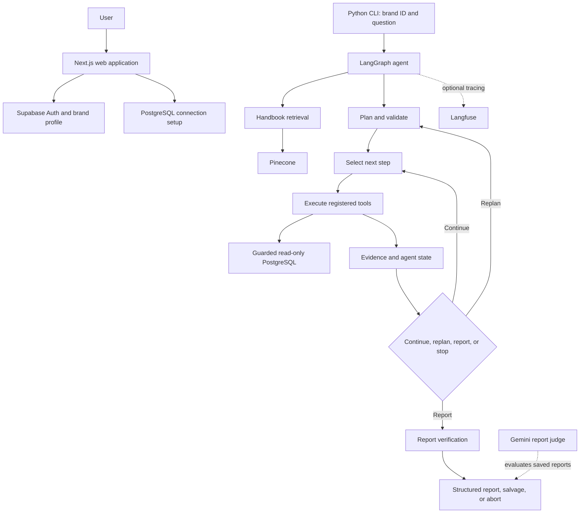
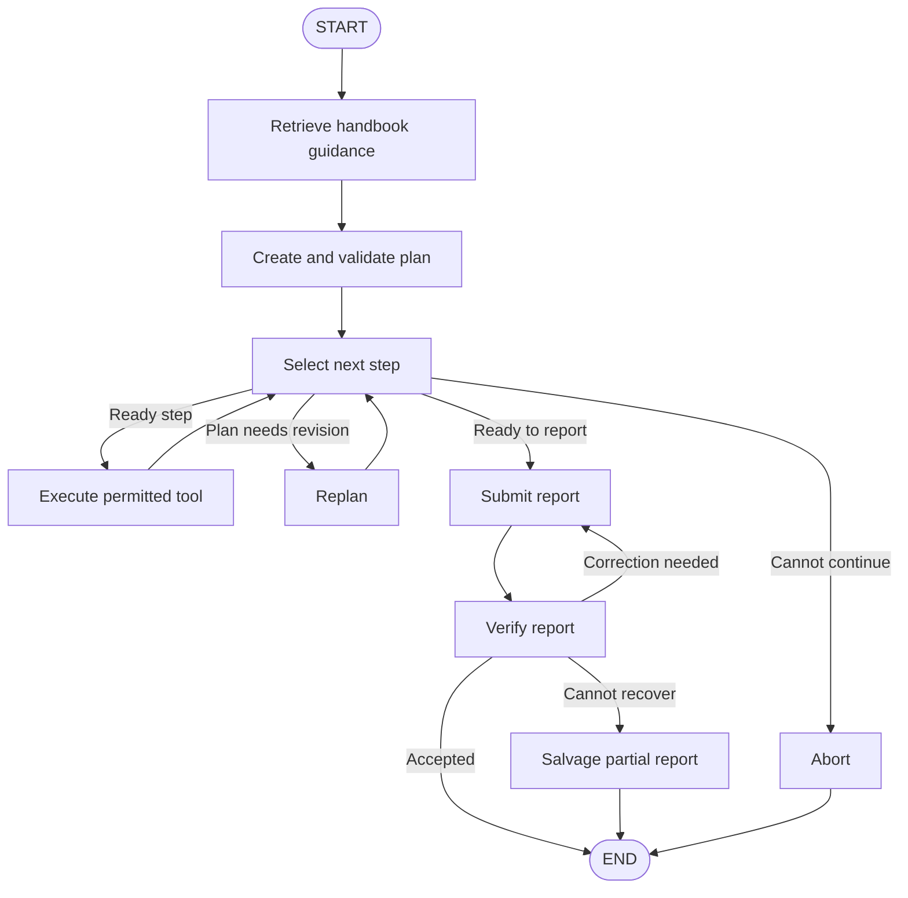
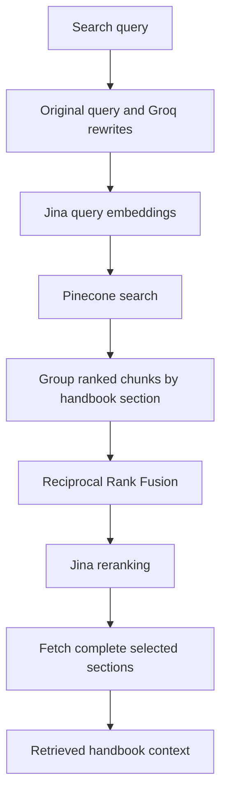
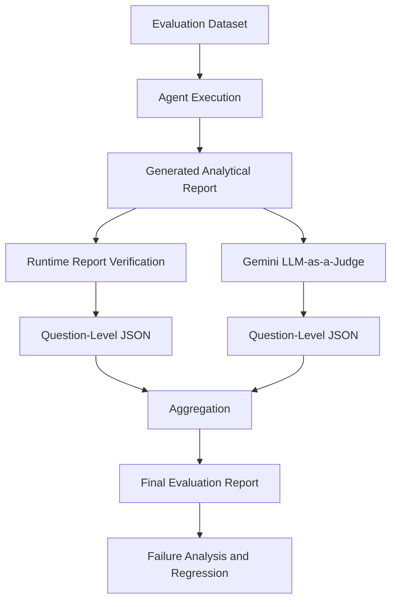

# Marketing Intelligence Platform
### An Evaluation-Driven Marketing Intelligence Agent Built with LangGraph

A context-aware marketing intelligence platform that combines brand onboarding and data setup in a Next.js application with a separate Python agent. The agent transforms supported marketing questions into structured investigations using stateful orchestration, general marketing handbook retrieval, approved business data, controlled tool execution, and report evaluation.

The Python agent is designed to go beyond conversational assistance. It combines an agent workflow with a report-evaluation harness to produce analytical reports grounded in available business evidence. The web dashboard assistant is currently a saved-brand-profile lookup; it is not connected to the Python agent or an LLM.

---

## Table of Contents

- [Overview](#overview)
- [Key Capabilities](#key-capabilities)
- [System Architecture](#system-architecture)
- [LangGraph Orchestration](#langgraph-orchestration)
- [Loop Engineering](#loop-engineering)
- [Context Engineering and RAG](#context-engineering-and-rag)
- [Retrieval Architecture](#retrieval-architecture)
- [Tool Engineering](#tool-engineering)
- [Evaluation Harness](#evaluation-harness)
- [Evaluation Metrics](#evaluation-metrics)
- [Observability and Tracing](#observability-and-tracing)
- [Reliability and Failure Handling](#reliability-and-failure-handling)
- [Security and Data Isolation](#security-and-data-isolation)
- [Technology Stack](#technology-stack)
- [Project Structure](#project-structure)
- [Installation and Configuration](#installation-and-configuration)
- [Evaluation Workflow](#evaluation-workflow)
- [Engineering Decisions](#engineering-decisions)
- [Limitations](#limitations)
- [Future Improvements](#future-improvements)
- [References](#references)

---

## Overview

Marketing teams frequently need to investigate questions involving campaign performance, customer acquisition, retention, customer segmentation, profitability, and marketing strategy.

Answering these questions requires more than retrieving documents or generating text. It requires combining business knowledge, brand context, analytical evidence, and domain-specific reasoning.

The Marketing Intelligence Platform addresses this problem through a stateful AI agent that can:

1. Interpret a marketing request and determine what analytical work it needs; the current graph has no separate request-classification node.
2. Identify the knowledge, brand context, and analytical capabilities required.
3. Retrieve relevant information from multiple knowledge sources.
4. Construct an investigation plan for complex requests.
5. Execute analytical operations through controlled tools.
6. Collect and organize intermediate evidence.
7. Evaluate execution results and identify missing information.
8. Continue execution, revise the investigation plan, or finalize the report.
9. Generate structured analytical reports with supporting evidence and limitations.

**Core engineering principle:** The LLM is responsible for interpretation and reasoning, while deterministic application logic controls execution, validation, and evaluation.

## Key Capabilities

| Capability | Description |
|---|---|
| Stateful agent orchestration | LangGraph-based workflow with explicit execution state and conditional transitions |
| Context engineering | Combines retrieved general marketing knowledge, brand context, and business-data evidence; standalone skills and web research are not implemented |
| Knowledge retrieval | Retrieves general marketing handbook sections from Pinecone; brand documents are not currently stored in a separate RAG index |
| Retrieval fusion | Uses Reciprocal Rank Fusion to combine retrieval results |
| Iterative investigation | Executes analytical steps and evaluates intermediate results |
| Dynamic replanning | Revises investigation steps when existing evidence is insufficient |
| Evidence management | Associates collected evidence with individual execution steps |
| Report validation and evaluation | Runtime report verification checks structure/evidence; a separate Gemini LLM judge evaluates saved reports |
| LLM observability | Terminal debug output and optional Langfuse instrumentation when configured |
| Brand-scoped context | The agent loads context for a brand ID; isolation depends on configured application policies and database grants |

---

## System Architecture

The application separates the user interface, agent orchestration, retrieval infrastructure, and evaluation infrastructure.


### Architectural separation

The platform separates four responsibilities:

**1. Application layer**
- User interface and request handling.
- User and brand context.
- Application-level data access.

**2. Intelligence layer**
- Request interpretation.
- Context retrieval.
- Planning and reasoning.
- Tool selection and execution.
- Report generation.

**3. Knowledge layer**
- General marketing handbook retrieved from Pinecone.
- Brand context and approved business data loaded through application/database configuration.
- Brand-document RAG, standalone procedural skills, and external web research are not implemented in the current agent.

**4. Quality and observability layer**
- Evaluation datasets.
- Deterministic validation.
- LLM-as-a-judge evaluation.
- Execution traces.
- Failure analysis.

---

## LangGraph Orchestration

LangGraph is used as the central orchestration framework because the application requires explicit state management, conditional execution, and iterative workflows.

Rather than implementing the agent as a single prompt followed by an LLM response, the workflow is represented as a graph of specialized processing nodes.

### High-level execution graph



### Node responsibilities

| Node | Responsibility |
|---|---|
| Guide | Retrieves relevant marketing handbook sections |
| Plan | Creates a structured investigation plan and validates tools and limits |
| Select step | Chooses a ready step or routes to replan, report, or abort |
| Execute | Runs registered investigation tools and records evidence |
| Replan | Revises the plan while preserving results for unchanged completed steps |
| Decide | Requests the final report through the report-only tool |
| Verify | Validates report structure, evidence support, and knowledge citations |
| Salvage | Preserves usable partial findings when a complete report cannot be accepted |
| Abort | Ends unsuccessful execution with a recorded reason |


The graph's routing decisions are explicit and depend on execution state and operation outcomes. The implementation has no separate request-router or evaluate node; step selection, execution, and verification nodes make these decisions.

### Explicit Agent State

The agent maintains structured execution information instead of relying exclusively on conversation messages.

The state tracks information such as:

- Original user question.
- Selected brand context.
- Investigation objective.
- Current investigation plan.
- Planned and completed steps.
- Individual step results.
- Collected evidence references.
- Tool execution information.
- Execution errors and rejections.
- Replanning information.
- Model and token usage.
- Investigation completion status.
- Next action and stop reason.
- Final report.

This enables the orchestration layer to make decisions using the accumulated execution state.

---

## Loop Engineering

One of the central design principles is that complex analytical tasks should be executed through a controlled feedback loop.

A traditional LLM workflow follows:

```text
Input -> Prompt -> LLM -> Output
```

This platform uses an iterative execution model:

```text
Understand
    |
Retrieve Context
    |
Plan
    |
Select Next Step
    |
Execute
    |
Observe
    |
Evaluate / Route
    |
Continue / Replan / Finalize
```


### 1. Plan

The planning component translates a business question into an investigation objective and a sequence of analytical operations.

A plan should define:

- Investigation objective.
- Required analytical steps.
- Expected outputs.
- Dependencies between steps.
- Success criteria.
- Relevant evidence requirements.

### 2. Execute

The execution controller processes individual steps through the available tool layer.

Each execution should produce a structured result containing its status, output, errors, and associated evidence references.

### 3. Observe

The observation layer updates the execution state with the results of completed operations.

This is important because the next decision must be based on actual execution outcomes rather than assumptions made during planning.

### 4. Evaluate

The graph state and routing logic determine whether:

- The current step succeeded.
- Required evidence was collected.
- The investigation plan remains valid.
- Additional operations are necessary.
- The report can be finalized.

This routing is distributed across selection, execution, replanning, and verification nodes; there is no standalone evaluation node in the implemented graph.

### 5. Replan

When the investigation encounters missing evidence, incomplete results, or an invalid plan, the workflow can revise its next steps.

Replanning should preserve useful completed work rather than blindly restarting the entire investigation.

### 6. Finalize or Abort

Finalization is allowed only when the workflow satisfies its completion conditions.

A missing report or failed finalization operation must not be represented as a successful analytical response.

### Execution boundaries

The loop is designed around explicit execution limits:

- Maximum step count.
- Maximum replan count.
- LLM call and token budgets.
- Tool execution constraints.
- Explicit completion conditions.
- Failure and abort states.

These limits are essential for controlling latency, model cost, and potentially unbounded agent execution.

---

## Context Engineering and RAG

The agent uses multiple context sources with different responsibilities. General handbook guidance is retrieved separately from brand context and business-data evidence. The current implementation does not place private brand documents in a separate vector collection.

### Context sources

| Source | Purpose |
|---|---|
| Skills | Procedural task guides are a possible extension; no standalone skill directory is implemented |
| Marketing Knowledge RAG | General marketing handbook retrieval from Pinecone; it supplies guidance, not evidence of brand results |
| Brand context | Brand profile and connection context loaded for the selected brand; brand-document vector RAG is not implemented |
| Business database | Approved PostgreSQL data queried through the agent's guarded tools |
| Web Research | Conditional external web research is not implemented in the current graph |
| Agent State | Information accumulated during the current investigation |

### Context preparation

The context preparation layer is responsible for selecting and assembling information relevant to the current request.

The objective is not to maximize the amount of retrieved information. It is to provide the agent with the information necessary to make grounded decisions.

For example, a request about declining customer retention may require:

1. Retention analysis procedures.
2. General marketing knowledge about churn and cohort analysis.
3. Brand-specific information.
4. Actual customer and transaction data.
5. External information only when the investigation requires it.

The different sources must remain distinguishable so general handbook knowledge is not confused with brand-specific evidence. Brand-document retrieval and web research in the examples above are future extensions, not current agent features.

---

## Retrieval Architecture

The implemented retrieval infrastructure searches general marketing handbook knowledge. Brand-specific documents are not currently indexed in a separate retrieval system.

### General Marketing Knowledge

**Vector database:** Pinecone

**Index:** `marketing-kb-jina`

**Namespace:** `handbook-md-jina-v5-small`

**Embedding model:** `jina-embeddings-v5-text-small`

**Vector dimension:** 1,024

The implemented pipeline expands the query with Groq, retrieves Pinecone results, groups results by handbook section, combines rankings with Reciprocal Rank Fusion (RRF), reranks candidates with Jina, and fetches complete selected sections. If expansion or reranking fails, the implementation has fallback behavior.

### Brand-Specific Knowledge

The application stores brand profile and database connection context, but the current agent does not retrieve brand documents through Supabase pgvector. Brand-specific evidence is obtained from the configured PostgreSQL business database through approved tools. Keeping general handbook guidance separate from brand data remains an important design boundary.

### Retrieval pipeline



### Retrieval engineering considerations

The retrieval layer is designed around:

- Separation of knowledge domains.
- Brand-aware retrieval.
- Semantic similarity.
- Rank fusion.
- Context selection.
- Retrieval relevance evaluation.
- Traceability of retrieved information.

Future retrieval improvements should be benchmarked against a fixed dataset rather than introduced solely because a technique is theoretically better.

---

## Tool Engineering

The platform separates LLM-driven task interpretation from the deterministic execution of analytical operations.

The LLM determines what investigation is needed. Application code determines how permitted operations are executed.

### Tool execution lifecycle

```text
Investigation Step
       |
Tool Selection
       |
Input Validation
       |
Execution Controls
       |
Tool Invocation
       |
Result Normalization
       |
Evidence Registration
       |
State Update
```

Important engineering principles include:

- Typed tool input and output contracts.
- Input validation before execution.
- Structured tool results.
- Explicit error propagation.
- Evidence registration.
- Execution limits.
- Controlled database access.
- Deterministic calculations for quantitative business metrics.

The objective is to prevent the LLM from becoming an unrestricted execution engine.

---

## Evaluation Harness

The repository includes a retrieval-evaluation workflow and a separate final-report judge harness. The judge uses Gemini to compare saved reports with question checklists, gold answers, and captured SQL evidence. Runtime report verification is a separate application component; the judge harness is LLM-based and is not a deterministic correctness evaluator.

### Evaluation architecture



### Evaluation dataset

The dataset contains 10 representative marketing questions and their expected analytical behavior, with a checklist for each question and a matching gold answer.

Evaluation cases define elements such as:

- Original business question.
- Expected analytical findings.
- Required checks.
- Expected explanations.
- Important notes and caveats.
- Relevant reference sections when they are identified in the case or retrieved from the handbook.
- Negative or irrelevant reference sections when supplied; these are not required fields in the current 10-question dataset.

This provides a repeatable evaluation basis for comparing agent behavior across changes.

### Question-level evaluation

Each question is evaluated independently.

Its result is saved as a JSON artifact containing the relevant scores, reasoning, and evidence references.

This design makes evaluation results inspectable and prevents a single aggregate score from hiding individual failures.

### Deterministic evaluation

Deterministic evaluation is responsible for explicit checks and measurable requirements.

Examples include:

- Required finding presence.
- Required analytical check completion.
- Evidence reference availability.
- Explicit numerical conditions.
- Structured output validation.

Where exact numerical correctness matters, the result should be recalculated from the underlying source data rather than delegated to an LLM judge.

### Semantic evaluation

The report-evaluation workflow uses Google Gemini through `google-genai` as an LLM judge. For each question, the judge receives:

- The original business question and its checklist of requirements.
- The question-specific gold answer and expected analysis dimensions.
- The agent-generated final report.
- The SQL evidence captured during the agent run.

The judge checks whether required findings and analytical dimensions appear in the report and whether report claims are supported by the supplied SQL evidence. It saves a score and explanation per question. The checked-in harness does not use DeepEval G-Eval; judge results are estimates, not verified business correctness.

---

## Evaluation Metrics

The evaluation framework includes complementary metrics for report completeness and analytical quality. The Gemini judge harness calculates checklist pass rate and analysis coverage. The other dimensions below describe evaluation criteria represented in the question files and judge prompt; they are not separate DeepEval metrics in the current code.

| Metric | Definition |
|---|---|
| Expected-story coverage | Percentage of expected analytical findings covered |
| Rule coverage | Percentage of required checks addressed |
| Reason coverage | Coverage of required analytical explanations |
| Note coverage | Coverage of required caveats and qualifications |
| Analysis coverage | Covered applicable analytical dimensions / all applicable dimensions |
| Check pass rate | Passed checklist items / total checklist items |
| LLM judge assessment | Gemini judge assessment of report checklist and applicable analysis dimensions |

### Analysis coverage

Analysis coverage measures the percentage of applicable analytical dimensions addressed by the report.

\[
\text{Analysis Coverage} =
\frac{\text{Covered Applicable Dimensions}}
{\text{All Applicable Dimensions}}
\times 100
\]

Non-applicable dimensions are excluded.

### Check pass rate

\[
\text{Check Pass Rate} =
\frac{\text{Passed Checks}}
{\text{Total Checks}}
\times 100
\]

The checked-in Gemini judge aggregation uses binary checklist scoring: passed check = 1, failed check = 0, and judge error = 0. Non-applicable analysis dimensions are excluded. This refers to the judge harness, not a standalone deterministic test suite.

### Evaluation artifacts

Individual question-level JSON files preserve:

- Question identifier.
- Checklist results.
- Pass/fail status.
- Evaluation reasons.
- Evidence references.
- Analysis dimensions.
- Consistency issues.
- LLM-judge evaluation results and explanations.

A separate aggregation stage calculates the final metrics across the evaluated questions.

**Important:** Runtime report verification and judge scores remain separate. Judge scores are subjective signals; use deterministic calculations for exact numerical correctness.

---

## Observability and Tracing

The agent provides terminal debug output. Optional Langfuse callbacks provide tracing when Langfuse credentials are configured.

When configured, tracing makes agent behavior inspectable beyond the final generated answer. Terminal debugging is available independently of Langfuse.

### Tracked execution information

- Graph node execution.
- LLM calls.
- Tool invocations.
- SQL operations.
- Token consumption.
- Execution state.
- Step results.
- Evidence references.
- Replanning and rejection counters.
- Completion status.
- Stop reasons.
- Errors.

### Debugging workflow

When an execution fails, the trace can be inspected to identify:

1. Which graph node was executing.
2. What input was provided to the node.
3. Which tool or model was invoked.
4. What the operation returned.
5. How the execution state changed.
6. Why the controller selected its next action.
7. Why the workflow completed or aborted.

This makes it possible to diagnose failures at the orchestration, retrieval, model, and tool-execution levels.

---

## Reliability and Failure Handling

The system is designed to distinguish successful analytical completion from partial or unsuccessful execution.

Important failure scenarios include:

| Failure scenario | Expected handling |
|---|---|
| Empty investigation plan | Reject or replan |
| Invalid tool arguments | Validation failure |
| Tool execution error | Structured error result |
| Missing evidence | Continue or revise the plan |
| Incomplete investigation | Do not claim successful completion |
| Missing final report | Enter failure handling |
| LLM budget exhaustion | Stop execution with an explicit reason |
| Invalid structured output | Reject or validate before downstream use |

### Example: Finalization failure

A recorded execution trace exposed a situation where the finalization model did not invoke the required `submit_report` operation.

The system detected that no report had been produced and entered its abort path instead of presenting a successful report.

This illustrates an important design principle:

**Successful LLM generation does not necessarily mean successful application execution.**

The application must validate the outcome against its own completion conditions.

---

## Security and Data Isolation

The application is designed around a user-to-brand data ownership model.

Brand-specific information must remain isolated from unrelated users and brands. The repository includes brand-scoped context and access-control mechanisms, but deployments must verify policies and grants; isolation should not be assumed from a brand ID alone.

The security architecture should enforce the following boundaries:

- Authenticated user context.
- Explicit brand ownership.
- Brand-scoped profile, connection, and business-data access.
- Database access restrictions.
- Environment-based secrets management.
- Least-privilege database credentials.
- Validated tool inputs.
- Restricted analytical database operations.

Supabase Row Level Security and database grants should enforce authorization at the data layer rather than relying exclusively on frontend filtering. The agent must not treat a user-supplied brand identifier as proof of authorization.

**Security verification is an essential part of the platform's production-hardening work.** Tenant-isolation claims should be supported by actual RLS policies and negative integration tests.

---

## Technology Stack

| Layer | Technologies |
|---|---|
| Frontend | Next.js, TypeScript |
| Agent orchestration | Python, LangGraph, LangChain |
| LLM integration | Google Generative AI via `langchain-google-genai` |
| Embeddings | Jina Embeddings v5 Text Small |
| General marketing handbook vector database | Pinecone |
| Brand data | Supabase profile/connection context and configured PostgreSQL business database; no brand-document pgvector RAG currently |
| Retrieval | Semantic search, Reciprocal Rank Fusion |
| Evaluation | Gemini LLM-as-a-judge harness; separate runtime report verification and retrieval evaluation |
| Observability | Langfuse |
| Structured validation | Pydantic |
| Configuration | Environment variables, structured configuration |

---

## Project Structure

The current repository structure is shown below. A second conceptual tree retains the directory architecture from the supplied example and marks each component as implemented or planned.

```text
marketing-intelligence-platform/
+-- src/
|   +-- app/                    # Next.js routes, pages, layouts, and API handlers
|   +-- components/             # Shared React UI
|   +-- lib/                    # Supabase, database, crypto, and MCP helpers
+-- agent/
|   +-- graph/                  # Graph, nodes, routing, state, execution control
|   +-- retrieval/              # Handbook retrieval and retrieval evaluation
|   +-- tools/                  # Schema, SQL, knowledge, and report tools
|   +-- security/               # Tenant context, SQL guard, audit helpers
|   +-- verification/           # Report checks and repair
|   +-- schemas/                # Plan and report schemas
|   +-- observability/          # Debugging and optional Langfuse tracing
|   +-- scripts/                # CLI and development utilities
|   +-- evals/                  # Agent run and retrieval evaluation artifacts
|   +-- tests/                  # Unit and integration tests
+-- marketing_agent_eval_harness/
|   +-- questions.json
|   +-- gold_answers.json
|   +-- judge_question.py
|   +-- aggregate_results.py
|   +-- judge_results/
+-- package.json
+-- agent/requirements.txt
+-- README.md
```
---

### Mapping of the example's conceptual project layout

The following names and responsibilities from the supplied architecture are retained. Planned entries do not exist as directories in the current checkout; their closest implemented files are identified.

```text
marketing-intelligence-platform/
+-- frontend/                         # Implemented as src/ (not a separate directory)
+-- agent/
|   +-- graph/
|   |   +-- nodes/                    # Implemented
|   |   +-- routing.py                # Implemented as a module, not routing/ directory
|   |   +-- state.py                  # Implemented
|   |   +-- execution_control.py      # Implemented
|   +-- retrieval/
|   |   +-- knowledge.py              # Implemented
|   |   +-- brand/                    # Planned; no brand-document RAG
|   |   +-- embeddings/               # Planned; Jina calls are in retrieval.py
|   |   +-- fusion/                   # Planned; RRF is in retrieval.py
|   +-- skills/                       # Planned
|   +-- tools/                        # Implemented
|   +-- prompts/                      # Implemented in agent/llm/prompts.py
|   +-- schemas/                      # Implemented
|   +-- observability/                # Implemented
+-- evaluation/                       # Implemented across agent/evals/ and marketing_agent_eval_harness/
|   +-- datasets/                     # questions.json in the harness
|   +-- goldens/                      # gold_answers.json in the harness
|   +-- scripts/                      # judge_question.py and aggregate_results.py
|   +-- results/                      # Saved JSON artifacts in both evaluation locations
|   +-- metrics/                      # Aggregate calculations in aggregate_results.py
|   +-- reports/                      # report_judge_eval.json
+-- tests/                            # Agent tests are under agent/tests/
+-- docs/                             # Planned; not present
+-- .env.example                      # Not present; use local env files documented below
+-- README.md
```

## Installation and Configuration

### Prerequisites

- Node.js 20.9 or later and npm for the web application.
- Python and the framework/provider dependencies required by the agent.
- Supabase project credentials.
- Google Generative AI, Pinecone, Jina, and Groq credentials for the agent.
- A configured PostgreSQL source database for business-data investigations.
- Gemini API credentials to rerun the report judge.

Python dependencies are listed in `agent/requirements.txt`, but the checked-in file may not include every package imported by the current runtime. Confirm missing framework/provider packages before setting up a clean environment.

### Environment configuration

Create `.env.local` in the repository root for the web application and `agent/.env` for the Python agent. The required credentials depend on the enabled integrations:

```dotenv
# Web app (.env.local)
NEXT_PUBLIC_SUPABASE_URL=
NEXT_PUBLIC_SUPABASE_PUBLISHABLE_KEY=
SUPABASE_SECRET_KEY=
CREDENTIALS_KEY=

# Python agent (agent/.env)
NEXT_PUBLIC_SUPABASE_URL=
SECRET_SUPABASE_KEY=
CREDENTIALS_KEY=
MODEL=
GOOGLE_API_KEY=
JINA_API_KEY=
GROQ_API_KEY=
PINECONE_API_KEY=

# Optional Langfuse tracing (agent/.env)
LANGFUSE_PUBLIC_KEY=
LANGFUSE_SECRET_KEY=
LANGFUSE_BASE_URL=
```

Never commit real API keys, database passwords, or service-role credentials.

The service-role key must remain on trusted server-side infrastructure and must never be exposed to the browser.

### Running the application

From the repository root, install and start the web application with `npm install` and `npm run dev`; this does not start the Python agent. The agent can be run from the repository root with `python -m agent.scripts.ask "<brand-id>" "<question>"`. The agent uses the configured Pinecone handbook index and approved PostgreSQL data; this repository does not require Supabase pgvector initialization for brand-document retrieval.

---

## Evaluation Workflow

The evaluation workflow should be executed independently from ordinary user interactions.

The checked-in `marketing_agent_eval_harness/` evaluates saved reports using Gemini. From that directory, install `requirements-judge.txt`, set `GEMINI_API_KEY`, run `python judge_question.py all`, then run `python aggregate_results.py --questions questions.json`. Use `python judge_question.py Q01 Q02` for selected questions. Per-question files are written to `judge_results/` and the aggregate to `report_judge_eval.json`. Agent run records can be produced from the repository root with `python -m agent.scripts.ask "<brand-id>" "<question>" --qid Q01 --out agent/evals/results.json`.

A complete evaluation cycle, following the structure above, is: (1) select the reference questions; (2) run the agent for each question; (3) capture reports, evidence, and execution records; (4) inspect runtime schema/evidence validation; (5) run the Gemini judge; (6) save per-question judge results; (7) aggregate results; (8) inspect misses, contradictions, and judge errors; (9) compare with the previous saved baseline; and (10) add new failure cases to the dataset. Exact numeric claims should be recalculated from the source rows; the current judge harness itself does not execute a separate deterministic metric suite.

The checked-in judge snapshot covers 10 questions and reports 92.0% analysis coverage (46/50 applicable dimensions) and 93.62% checklist pass rate (44/47 checks). These are LLM-judge results for that saved sample, not a production accuracy claim. The judge is not calibrated against human labels, and the sample is small. Review misses and recompute important numeric results from source data.

The objective is to make improvements measurable and prevent previously solved problems from reappearing.

---

## Engineering Decisions

| Decision | Rationale |
|---|---|
| LangGraph over a simple sequential chain | Complex investigations require explicit state and conditional execution |
| Separate handbook guidance and business evidence | Prevent general marketing knowledge from being mistaken for brand results |
| Pinecone for handbook retrieval | Dedicated retrieval infrastructure for general marketing knowledge |
| PostgreSQL tools for brand evidence | Queries configured business data under database permissions; no brand-document pgvector RAG is implemented |
| RRF retrieval fusion | Combines ranked retrieval results without depending on a single ranking source |
| Explicit execution state | Makes investigation progress and failures inspectable |
| Separate runtime verification and report judging | Runtime evidence checks and Gemini judge scores serve different purposes |
| Question-level evaluation artifacts | Supports debugging and reproducible aggregation |
| Optional Langfuse instrumentation | Adds tracing when configured; terminal debug output is also available |

---

## Limitations

The system is an evolving AI engineering project. The following areas require continued validation and hardening:

- Retrieval quality must be benchmarked against a labeled dataset.
- The current report judge is Gemini-based; DeepEval G-Eval is not used by the checked-in harness.
- LLM-as-a-judge scores require human calibration.
- Numerical findings require deterministic verification.
- Replanning must be constrained by explicit budgets.
- Authorization must be tested across users and brands.
- Prompt injection and untrusted retrieved content require security testing.
- Production latency and inference cost require systematic measurement.
- Persistent execution recovery and deployment reliability require dedicated validation.

No production-scale performance or accuracy claims are made without corresponding benchmark results.

---

## Future Improvements

### Agent Engineering
- More comprehensive trajectory evaluation.
- Improved plan validation and execution policies.
- Better recovery and resume behavior.
- Human approval for sensitive operations.

### Retrieval Engineering
- Retrieval recall and precision benchmarks.
- Metadata filtering.
- Reranking experiments.
- Context compression and token-budget optimization.
- Retrieval regression testing.

### Evaluation Engineering
- Automated regression evaluation in CI.
- Human-labeled evaluation datasets.
- Tool correctness and argument correctness metrics.
- Faithfulness and contextual relevance evaluation.
- Automated failure-case discovery.

### Production Infrastructure
- Persistent LangGraph checkpointing.
- FastAPI production service.
- Docker-based reproducible deployment.
- Authentication and authorization tests.
- Structured logging and distributed tracing.
- Rate limiting and resource budgets.
- Model and prompt versioning.
- Cost and latency monitoring.

---

## References

- [LangGraph Documentation](https://docs.langchain.com/oss/python/langgraph/overview)
- [LangGraph Persistence and Checkpointing](https://docs.langchain.com/oss/python/langgraph/persistence)
- [LangGraph Conditional Workflows](https://docs.langchain.com/oss/python/langgraph/graph-api)
- [Langfuse Documentation](https://langfuse.com/docs)
- [DeepEval Documentation](https://deepeval.com/docs/introduction) (reference only; not used by the current harness)
- [DeepEval G-Eval](https://deepeval.com/docs/metrics-llm-evals) (reference only; not used by the current harness)
- [Pinecone Documentation](https://docs.pinecone.io/)
- [Supabase Documentation](https://supabase.com/docs)
- [Supabase pgvector](https://supabase.com/docs/guides/database/extensions/pgvector) (potential future brand-document retrieval)
- [Jina AI Documentation](https://jina.ai/embeddings/)

---

**Built to demonstrate AI systems engineering: stateful orchestration, marketing handbook retrieval, controlled data analysis, evidence-aware reporting, evaluation-driven development, and observable agent behavior.**