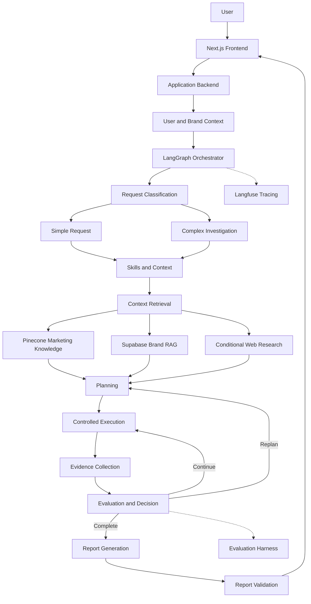
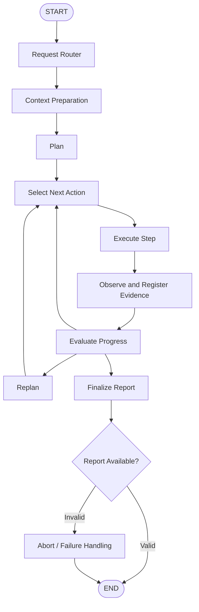
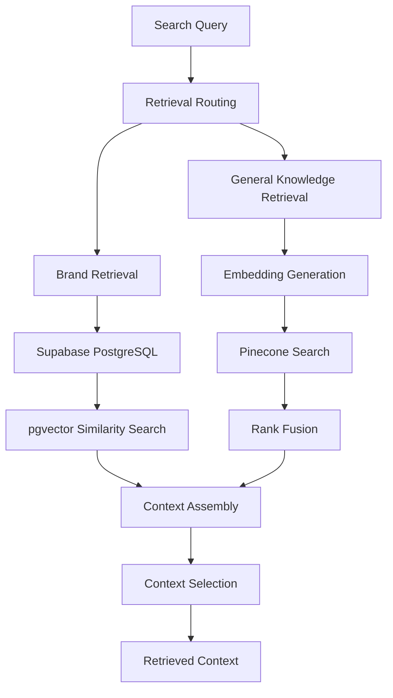
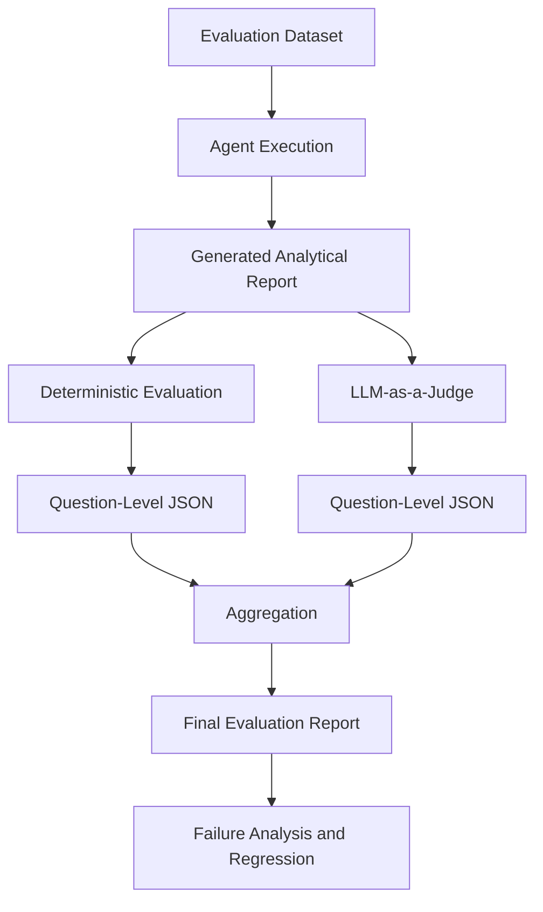

# Marketing Intelligence Platform
### An Evaluation-Driven Marketing Intelligence Agent Built with LangGraph

A context-aware AI platform that transforms marketing questions into structured business investigations using stateful agent orchestration, knowledge retrieval, brand-specific context, controlled tool execution, and iterative evaluation.

The platform is designed to go beyond conversational marketing assistance. It combines an agentic reasoning workflow with an evaluation harness to produce analytical reports grounded in available business evidence.

---

## Table of Contents

- [Overview](#overview)
- [Key Capabilities](#key-capabilities)
- [System Architecture](#system-architecture)
- [LangGraph Orchestration](#langgraph-orchestration)
- [Loop Engineering](#loop-engineering)
- [Context Engineering and RAG](#context-engineering-and-rag)
- [Retrieval Architecture](#retrieval-architecture)
- [Tool Engineering](#tool-engineering)
- [Evaluation Harness](#evaluation-harness)
- [Evaluation Metrics](#evaluation-metrics)
- [Observability and Tracing](#observability-and-tracing)
- [Reliability and Failure Handling](#reliability-and-failure-handling)
- [Security and Data Isolation](#security-and-data-isolation)
- [Technology Stack](#technology-stack)
- [Project Structure](#project-structure)
- [Installation and Configuration](#installation-and-configuration)
- [Evaluation Workflow](#evaluation-workflow)
- [Engineering Decisions](#engineering-decisions)
- [Limitations](#limitations)
- [Future Improvements](#future-improvements)
- [References](#references)

---

## Overview

Marketing teams frequently need to investigate questions involving campaign performance, customer acquisition, retention, customer segmentation, profitability, and marketing strategy.

Answering these questions requires more than retrieving documents or generating text. It requires combining business knowledge, brand context, analytical evidence, and domain-specific reasoning.

The Marketing Intelligence Platform addresses this problem through a stateful AI agent that can:

1. Understand and classify a marketing request.
2. Identify the knowledge, brand context, and analytical capabilities required.
3. Retrieve relevant information from multiple knowledge sources.
4. Construct an investigation plan for complex requests.
5. Execute analytical operations through controlled tools.
6. Collect and organize intermediate evidence.
7. Evaluate execution results and identify missing information.
8. Continue execution, revise the investigation plan, or finalize the report.
9. Generate structured analytical reports with supporting evidence and limitations.

**Core engineering principle:** The LLM is responsible for interpretation and reasoning, while deterministic application logic controls execution, validation, and evaluation.

## Key Capabilities

| Capability | Description |
|---|---|
| Stateful agent orchestration | LangGraph-based workflow with explicit execution state and conditional transitions |
| Context engineering | Combines procedural skills, general marketing knowledge, brand-specific context, and external information |
| Multi-source RAG | Separates reusable domain knowledge from private brand documents |
| Retrieval fusion | Uses Reciprocal Rank Fusion to combine retrieval results |
| Iterative investigation | Executes analytical steps and evaluates intermediate results |
| Dynamic replanning | Revises investigation steps when existing evidence is insufficient |
| Evidence management | Associates collected evidence with individual execution steps |
| Structured evaluation | Separates deterministic checks from LLM-based semantic evaluation |
| LLM observability | Langfuse instrumentation for investigating model and tool execution |
| Multi-brand architecture | Organizes brand-specific context within the application |

---

## System Architecture

The application separates the user interface, agent orchestration, retrieval infrastructure, and evaluation infrastructure.



### Architectural separation

The platform separates four responsibilities:

**1. Application layer**
- User interface and request handling.
- User and brand context.
- Application-level data access.

**2. Intelligence layer**
- Request interpretation.
- Context retrieval.
- Planning and reasoning.
- Tool selection and execution.
- Report generation.

**3. Knowledge layer**
- General marketing knowledge.
- Brand-specific documents.
- Procedural skills.
- External research.

**4. Quality and observability layer**
- Evaluation datasets.
- Deterministic validation.
- LLM-as-a-judge evaluation.
- Execution traces.
- Failure analysis.

---

## LangGraph Orchestration

LangGraph is used as the central orchestration framework because the application requires explicit state management, conditional execution, and iterative workflows.

Rather than implementing the agent as a single prompt followed by an LLM response, the workflow is represented as a graph of specialized processing nodes.

### High-level execution graph



### Node responsibilities

| Node | Responsibility |
|---|---|
| Request router | Determines the appropriate processing path |
| Context preparation | Retrieves the required knowledge and brand information |
| Plan | Creates a structured investigation plan |
| Decide | Selects the next permitted execution action |
| Execute | Executes the current analytical step |
| Observe | Captures execution outcomes and evidence |
| Evaluate | Determines whether the investigation can continue or finish |
| Replan | Revises the investigation when additional work is necessary |
| Finalize | Produces the final analytical report |
| Abort | Handles unsuccessful or incomplete execution |

The graph's routing decisions are explicit. Each transition is determined by the execution state and the outcome of the current operation.

### Explicit Agent State

The agent maintains structured execution information instead of relying exclusively on conversation messages.

The state tracks information such as:

- Original user question.
- Selected brand context.
- Investigation objective.
- Current investigation plan.
- Planned and completed steps.
- Individual step results.
- Collected evidence references.
- Tool execution information.
- Execution errors and rejections.
- Replanning information.
- Model and token usage.
- Investigation completion status.
- Next action and stop reason.
- Final report.

This enables the orchestration layer to make decisions using the accumulated execution state.

---

## Loop Engineering

One of the central design principles is that complex analytical tasks should be executed through a controlled feedback loop.

A traditional LLM workflow follows:

```text
Input → Prompt → LLM → Output
```

This platform uses an iterative execution model:

```text
Understand
    ↓
Retrieve Context
    ↓
Plan
    ↓
Select Next Step
    ↓
Execute
    ↓
Observe
    ↓
Evaluate
    ↓
Continue / Replan / Finalize
```

### 1. Plan

The planning component translates a business question into an investigation objective and a sequence of analytical operations.

A plan should define:

- Investigation objective.
- Required analytical steps.
- Expected outputs.
- Dependencies between steps.
- Success criteria.
- Relevant evidence requirements.

### 2. Execute

The execution controller processes individual steps through the available tool layer.

Each execution should produce a structured result containing its status, output, errors, and associated evidence references.

### 3. Observe

The observation layer updates the execution state with the results of completed operations.

This is important because the next decision must be based on actual execution outcomes rather than assumptions made during planning.

### 4. Evaluate

The evaluation component determines whether:

- The current step succeeded.
- Required evidence was collected.
- The investigation plan remains valid.
- Additional operations are necessary.
- The report can be finalized.

### 5. Replan

When the investigation encounters missing evidence, incomplete results, or an invalid plan, the workflow can revise its next steps.

Replanning should preserve useful completed work rather than blindly restarting the entire investigation.

### 6. Finalize or Abort

Finalization is allowed only when the workflow satisfies its completion conditions.

A missing report or failed finalization operation must not be represented as a successful analytical response.

### Execution boundaries

The loop is designed around explicit execution limits:

- Maximum step count.
- Maximum replan count.
- LLM call and token budgets.
- Tool execution constraints.
- Explicit completion conditions.
- Failure and abort states.

These limits are essential for controlling latency, model cost, and potentially unbounded agent execution.

---

## Context Engineering and RAG

The platform uses multiple context sources with different responsibilities.

Instead of placing every document into a single knowledge collection, it separates general marketing knowledge from brand-specific information.

### Context sources

| Source | Purpose |
|---|---|
| Skills | Procedural knowledge describing how specific tasks should be performed |
| Marketing Knowledge RAG | General marketing methodologies and domain knowledge |
| Brand RAG | Private brand documents and business context |
| Web Research | Current external information when required |
| Agent State | Relevant information accumulated during the current investigation |

### Context preparation

The context preparation layer is responsible for selecting and assembling information relevant to the current request.

The objective is not to maximize the amount of retrieved information. It is to provide the agent with the information necessary to make grounded decisions.

For example, a request about declining customer retention may require:

1. Retention analysis procedures.
2. General marketing knowledge about churn and cohort analysis.
3. Brand-specific information.
4. Actual customer and transaction data.
5. External information only when the investigation requires it.

The different sources must remain distinguishable so that general knowledge is not confused with brand-specific evidence.

---

## Retrieval Architecture

The retrieval infrastructure separates general marketing knowledge from brand-specific documents.

### General Marketing Knowledge

**Vector database:** Pinecone

**Index:** `marketing-knowledge`

**Embedding model:** `jina-embeddings-v5-text-small`

**Vector dimension:** 1,024

**Similarity metric:** Cosine

The general knowledge retrieval pipeline uses embedding-based retrieval and Reciprocal Rank Fusion (RRF) to combine ranked retrieval results.

### Brand-Specific Knowledge

**Database:** Supabase PostgreSQL

**Vector extension:** pgvector

Brand-specific documents are stored separately from general marketing knowledge.

This separation supports brand-aware retrieval and provides a foundation for user and brand data isolation.

### Retrieval pipeline



### Retrieval engineering considerations

The retrieval layer is designed around:

- Separation of knowledge domains.
- Brand-aware retrieval.
- Semantic similarity.
- Rank fusion.
- Context selection.
- Retrieval relevance evaluation.
- Traceability of retrieved information.

Future retrieval improvements should be benchmarked against a fixed dataset rather than introduced solely because a technique is theoretically better.

---

## Tool Engineering

The platform separates LLM-driven task interpretation from the deterministic execution of analytical operations.

The LLM determines what investigation is needed. Application code determines how permitted operations are executed.

### Tool execution lifecycle

```text
Investigation Step
       ↓
Tool Selection
       ↓
Input Validation
       ↓
Execution Controls
       ↓
Tool Invocation
       ↓
Result Normalization
       ↓
Evidence Registration
       ↓
State Update
```

Important engineering principles include:

- Typed tool input and output contracts.
- Input validation before execution.
- Structured tool results.
- Explicit error propagation.
- Evidence registration.
- Execution limits.
- Controlled database access.
- Deterministic calculations for quantitative business metrics.

The objective is to prevent the LLM from becoming an unrestricted execution engine.

---

## Evaluation Harness

The platform includes a dedicated evaluation workflow to assess analytical report quality.

The evaluation system separates two fundamentally different questions:

1. Did the report satisfy explicit, objectively checkable requirements?
2. Does the report semantically address the business question with sufficient quality?

These should not be measured using the same evaluation method.

### Evaluation architecture



### Evaluation dataset

The dataset contains representative marketing questions and their expected analytical behavior.

Evaluation cases define elements such as:

- Original business question.
- Expected analytical findings.
- Required checks.
- Expected explanations.
- Important notes and caveats.
- Relevant reference sections.
- Negative or irrelevant reference sections.

This provides a repeatable evaluation basis for comparing agent behavior across changes.

### Question-level evaluation

Each question is evaluated independently.

Its result is saved as a JSON artifact containing the relevant scores, reasoning, and evidence references.

This design makes evaluation results inspectable and prevents a single aggregate score from hiding individual failures.

### Deterministic evaluation

Deterministic evaluation is responsible for explicit checks and measurable requirements.

Examples include:

- Required finding presence.
- Required analytical check completion.
- Evidence reference availability.
- Explicit numerical conditions.
- Structured output validation.

Where exact numerical correctness matters, the result should be recalculated from the underlying source data rather than delegated to an LLM judge.

### Semantic evaluation

The project uses DeepEval G-Eval for semantic quality evaluation.

The current evaluation script configures:

- Evaluation framework: DeepEval.
- Metric: G-Eval.
- Judge model: Configurable.
- Threshold: 0.8.
- Input: Original business question.
- Actual output: Agent-generated report.
- Expected output: Question-specific golden expectations.

The semantic evaluation produces a score and an explanation.

LLM-as-a-judge results are treated as advisory signals and are not equivalent to verified business correctness.

---

## Evaluation Metrics

The evaluation framework includes complementary metrics for assessing report completeness and analytical quality.

| Metric | Definition |
|---|---|
| Expected-story coverage | Percentage of expected analytical findings covered |
| Rule coverage | Percentage of required checks addressed |
| Reason coverage | Coverage of required analytical explanations |
| Note coverage | Coverage of required caveats and qualifications |
| Analysis coverage | Covered applicable analytical dimensions / all applicable dimensions |
| Check pass rate | Passed checklist items / total checklist items |
| Semantic quality | G-Eval assessment of report quality |

### Analysis coverage

Analysis coverage measures the percentage of applicable analytical dimensions addressed by the report.

\[
\text{Analysis Coverage} =
\frac{\text{Covered Applicable Dimensions}}
{\text{All Applicable Dimensions}}
\times 100
\]

Non-applicable dimensions are excluded.

### Check pass rate

\[
\text{Check Pass Rate} =
\frac{\text{Passed Checks}}
{\text{Total Checks}}
\times 100
\]

The current aggregation uses binary scoring:

- Passed check: 1.
- Failed check: 0.
- Judge error: 0.
- Not-applicable analysis dimension: excluded.

### Evaluation artifacts

Individual question-level JSON files preserve:

- Question identifier.
- Checklist results.
- Pass/fail status.
- Evaluation reasons.
- Evidence references.
- Analysis dimensions.
- Consistency issues.
- Semantic evaluation results.

A separate aggregation stage calculates the final metrics across the evaluated questions.

**Important:** Deterministic checks and semantic judge scores remain separate so that subjective model judgments cannot conceal objective failures.

---

## Observability and Tracing

Langfuse is integrated into the agent workflow to provide visibility into LLM execution and debugging.

The objective is to make the agent's behavior inspectable beyond the final generated answer.

### Tracked execution information

- Graph node execution.
- LLM calls.
- Tool invocations.
- SQL operations.
- Token consumption.
- Execution state.
- Step results.
- Evidence references.
- Replanning and rejection counters.
- Completion status.
- Stop reasons.
- Errors.

### Debugging workflow

When an execution fails, the trace can be inspected to identify:

1. Which graph node was executing.
2. What input was provided to the node.
3. Which tool or model was invoked.
4. What the operation returned.
5. How the execution state changed.
6. Why the controller selected its next action.
7. Why the workflow completed or aborted.

This makes it possible to diagnose failures at the orchestration, retrieval, model, and tool-execution levels.

---

## Reliability and Failure Handling

The system is designed to distinguish successful analytical completion from partial or unsuccessful execution.

Important failure scenarios include:

| Failure scenario | Expected handling |
|---|---|
| Empty investigation plan | Reject or replan |
| Invalid tool arguments | Validation failure |
| Tool execution error | Structured error result |
| Missing evidence | Continue or revise the plan |
| Incomplete investigation | Do not claim successful completion |
| Missing final report | Enter failure handling |
| LLM budget exhaustion | Stop execution with an explicit reason |
| Invalid structured output | Reject or validate before downstream use |

### Example: Finalization failure

A recorded execution trace exposed a situation where the finalization model did not invoke the required `submit_report` operation.

The system detected that no report had been produced and entered its abort path instead of presenting a successful report.

This illustrates an important design principle:

**Successful LLM generation does not necessarily mean successful application execution.**

The application must validate the outcome against its own completion conditions.

---

## Security and Data Isolation

The application is designed around a user-to-brand data ownership model.

Brand-specific information must remain isolated from unrelated users and brands.

The security architecture should enforce the following boundaries:

- Authenticated user context.
- Explicit brand ownership.
- Brand-scoped document retrieval.
- Database access restrictions.
- Environment-based secrets management.
- Least-privilege database credentials.
- Validated tool inputs.
- Restricted analytical database operations.

Supabase Row Level Security should enforce authorization at the database layer rather than relying exclusively on frontend filtering.

The agent must never treat a user-supplied brand identifier as proof of authorization.

**Security verification is an essential part of the platform's production-hardening work.** Tenant-isolation claims should be supported by actual RLS policies and negative integration tests.

---

## Technology Stack

| Layer | Technologies |
|---|---|
| Frontend | Next.js, TypeScript |
| Agent orchestration | Python, LangGraph, LangChain |
| LLM integration | Configurable LLM providers |
| Embeddings | Jina Embeddings v5 Text Small |
| General knowledge vector database | Pinecone |
| Brand document database | Supabase, PostgreSQL, pgvector |
| Retrieval | Semantic search, Reciprocal Rank Fusion |
| Evaluation | DeepEval, G-Eval, deterministic Python evaluation |
| Observability | Langfuse |
| Structured validation | Pydantic |
| Configuration | Environment variables, structured configuration |

---

## Project Structure

The following is a conceptual view of the main engineering responsibilities. Actual directory names should match the repository implementation.

```text
marketing-intelligence-platform/
│
├── frontend/
│   └── Next.js application
│
├── agent/
│   ├── graph/
│   │   ├── nodes/
│   │   ├── routing/
│   │   ├── state/
│   │   └── execution_control/
│   │
│   ├── retrieval/
│   │   ├── knowledge/
│   │   ├── brand/
│   │   ├── embeddings/
│   │   └── fusion/
│   │
│   ├── skills/
│   ├── tools/
│   ├── prompts/
│   ├── schemas/
│   └── observability/
│
├── evaluation/
│   ├── datasets/
│   ├── goldens/
│   ├── scripts/
│   ├── results/
│   ├── metrics/
│   └── reports/
│
├── tests/
│   ├── unit/
│   ├── integration/
│   └── evaluation/
│
├── docs/
│   ├── architecture.md
│   ├── retrieval.md
│   ├── evaluation.md
│   └── security.md
│
├── .env.example
└── README.md
```

---

## Installation and Configuration

### Prerequisites

- Python.
- Node.js.
- Access to the configured LLM provider.
- Pinecone account and API credentials.
- Supabase project and database credentials.
- Langfuse credentials if tracing is enabled.

### Environment configuration

Create a local environment file using the provided example configuration.

The required credentials depend on the enabled integrations:

```dotenv
# LLM provider
LLM_API_KEY=

# Pinecone
PINECONE_API_KEY=

# Supabase
SUPABASE_URL=
SUPABASE_ANON_KEY=
SUPABASE_SERVICE_ROLE_KEY=

# Langfuse
LANGFUSE_PUBLIC_KEY=
LANGFUSE_SECRET_KEY=
LANGFUSE_BASE_URL=
```

Never commit real API keys, database passwords, or service-role credentials.

The service-role key must remain on trusted server-side infrastructure and must never be exposed to the browser.

### Running the application

Follow the installation and startup commands provided by the frontend and backend dependency configurations.

Database extensions, vector indexes, and required schema migrations must be initialized before running brand-specific retrieval.

---

## Evaluation Workflow

The evaluation workflow should be executed independently from ordinary user interactions.

A typical evaluation cycle:

1. Select an evaluation dataset.
2. Execute each business question against the agent.
3. Capture the resulting report and execution artifacts.
4. Run deterministic checks.
5. Run semantic evaluation where configured.
6. Save each question's evaluation result.
7. Aggregate question-level results.
8. Inspect failed checks and semantic disagreements.
9. Compare results against the previous baseline.
10. Update the evaluation dataset with newly discovered failure cases.

The objective is to make improvements measurable and prevent previously solved problems from reappearing.

---

## Engineering Decisions

| Decision | Rationale |
|---|---|
| LangGraph over a simple sequential chain | Complex investigations require explicit state and conditional execution |
| Separate general and brand knowledge | Avoid mixing reusable domain knowledge with private business information |
| Pinecone for general knowledge | Dedicated vector retrieval infrastructure |
| Supabase pgvector for brand documents | Keeps brand-specific information within the application database architecture |
| RRF retrieval fusion | Combines ranked retrieval results without depending on a single ranking source |
| Explicit execution state | Makes investigation progress and failures inspectable |
| Separate evaluation stages | Prevents semantic judgments from replacing deterministic validation |
| Question-level evaluation artifacts | Supports debugging and reproducible aggregation |
| Langfuse instrumentation | Makes model and tool execution observable |

---

## Limitations

The system is an evolving AI engineering project. The following areas require continued validation and hardening:

- Retrieval quality must be benchmarked against a labeled dataset.
- LLM-as-a-judge scores require human calibration.
- Numerical findings require deterministic verification.
- Replanning must be constrained by explicit budgets.
- Authorization must be tested across users and brands.
- Prompt injection and untrusted retrieved content require security testing.
- Production latency and inference cost require systematic measurement.
- Persistent execution recovery and deployment reliability require dedicated validation.

No production-scale performance or accuracy claims are made without corresponding benchmark results.

---

## Future Improvements

### Agent Engineering
- More comprehensive trajectory evaluation.
- Improved plan validation and execution policies.
- Better recovery and resume behavior.
- Human approval for sensitive operations.

### Retrieval Engineering
- Retrieval recall and precision benchmarks.
- Metadata filtering.
- Reranking experiments.
- Context compression and token-budget optimization.
- Retrieval regression testing.

### Evaluation Engineering
- Automated regression evaluation in CI.
- Human-labeled evaluation datasets.
- Tool correctness and argument correctness metrics.
- Faithfulness and contextual relevance evaluation.
- Automated failure-case discovery.

### Production Infrastructure
- Persistent LangGraph checkpointing.
- FastAPI production service.
- Docker-based reproducible deployment.
- Authentication and authorization tests.
- Structured logging and distributed tracing.
- Rate limiting and resource budgets.
- Model and prompt versioning.
- Cost and latency monitoring.

---

## References

- [LangGraph Documentation](https://docs.langchain.com/oss/python/langgraph/overview)
- [LangGraph Persistence and Checkpointing](https://docs.langchain.com/oss/python/langgraph/persistence)
- [LangGraph Conditional Workflows](https://docs.langchain.com/oss/python/langgraph/graph-api)
- [Langfuse Documentation](https://langfuse.com/docs)
- [DeepEval Documentation](https://deepeval.com/docs/introduction)
- [DeepEval G-Eval](https://deepeval.com/docs/metrics-llm-evals)
- [Pinecone Documentation](https://docs.pinecone.io/)
- [Supabase Documentation](https://supabase.com/docs)
- [Supabase pgvector](https://supabase.com/docs/guides/database/extensions/pgvector)
- [Jina AI Documentation](https://jina.ai/embeddings/)

---

**Built to demonstrate AI systems engineering: stateful orchestration, retrieval and context engineering, controlled execution, evaluation-driven development, and observable agent behavior.**
